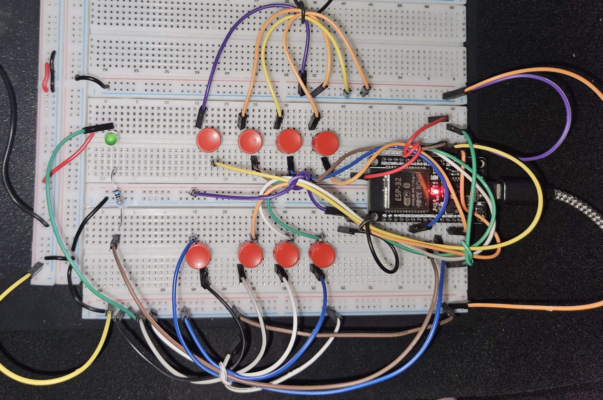

# Smart Feedback Device

An ESP32-based classroom feedback system: students press physical buttons (Understand, Confused, Lost, Slow down...) and the professor watches a live dashboard of the room's comprehension in real time.

Built as a 4-person cornerstone design project. I wrote the firmware and the web dashboard.

## What it does

- 8 physical buttons across response categories (understand, confused, lost, slow down, repeat that, yes, no, need an example)
- Proper debounce handling so one press never counts twice
- ESP32 hosts a web server; the dashboard polls for new data every 2 seconds
- Live bar chart of responses, total count, and current top response
- Optional Gemini AI integration: paste an API key in the dashboard and it generates a plain-language summary with a pacing recommendation for the instructor
- Green LED flashes on every registered press; dashboard has a reset button

## Hardware

- ESP32 microcontroller
- 8 tactile push buttons (GPIO 4, 5, 13, 14, 15, 18, 19, 32)
- Green LED (GPIO 26) for press feedback

## Firmware

Single Arduino sketch (`Smart-Feedback.ino`). WiFi credentials are placeholders, fill in your own. No API keys are stored in the code; the Gemini key is entered in the browser at runtime.

## Status

Working prototype.

## Demo

